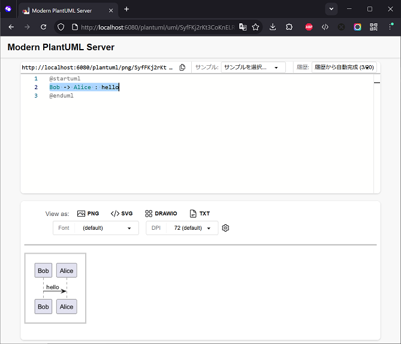

# Modern PlantUML Server
**テキストを入力するだけ。ブラウザ上ですぐに美しい図が描ける作図ツール**
元「PlantUML Server」の改善版

## スクリーンショット



---

#### 🌟 **改善ポイント**
- **インストール不要・ブラウザですぐ使える**: 
  面倒な専用ソフトを入れなくても、ブラウザを開くだけですぐに設計図やフローチャートを作れます。
- **リアルタイムで見ながら編集**: 
  文字を打ち込むと、その場でシーケンス図やクラス図がリアルタイムにプレビュー表示されます。
- **豊富なサンプルから選んでスタート**: 
  テンプレートを選ぶだけですぐに書き始められるので、初めての方でも迷いません。
- **ワンクリックで画像保存**: 
  仕上がった図は SVG・PNG 画像として手軽にダウンロードでき、資料作成や共有もスムーズです。


## 動作環境

- JDK 17 以上

## 起動方法

### 1. コマンドラインでの起動

#### Windows
```cmd
java -jar modern_plantuml_server.jar
```
またはバッチファイルで起動:
```cmd
.\modern_plantuml_server.bat
```

#### Linux
```bash
java -jar modern_plantuml_server.jar
```

### 2. ブラウザでアクセス

起動後、ブラウザで以下の URL にアクセスします:
- http://localhost:6080/plantuml

---

## 詳細設定

### 環境変数一覧

| 環境変数 | 説明 | 初期値 |
| :--- | :--- | :--- |
| `JAVA_HOME` | Java のインストールパス | Linux サービス: `/usr/lib/jvm/java-17-openjdk-17.0.16.0.8-2.el9.x86_64` (Windows: 自動検出) |
| `PLANTUML_SERVER_PORT` | サーバーのポート番号 | `6080` |
| `PLANTUML_SERVER_CONTEXTPATH` | コンテキストパス | `/plantuml` |
| `FONT_PATH` | フォントディレクトリパス（未設定時は OS フォントを表示） | なし（OS フォント） |
| `SAMPLE_PATH` | サンプルダイアグラムのディレクトリパス（未設定時は内部リソースを参照） | なし（内部リソース `static/sample`） |

### Linux（systemd サービスとして起動）

1. `modern_plantuml_server.service` の設定内容を確認・必要に応じて編集します。
2. 以下のパスに配置します:
   ```bash
   sudo cp modern_plantuml_server.service /etc/systemd/system/
   ```
3. サービスとして登録・起動します:
   ```bash
   sudo systemctl enable modern_plantuml_server
   sudo systemctl start modern_plantuml_server
   ```

### Windows（バッチファイルで起動）

1. `modern_plantuml_server.bat` の設定内容を確認・必要に応じて環境変数を指定します。
2. 同じフォルダーに `modern_plantuml_server.jar` を配置して実行します:
   ```cmd
   .\modern_plantuml_server.bat
   ```

---

## 関連ドキュメント

- [エンドユーザー向け操作マニュアル](user_manual.md)


